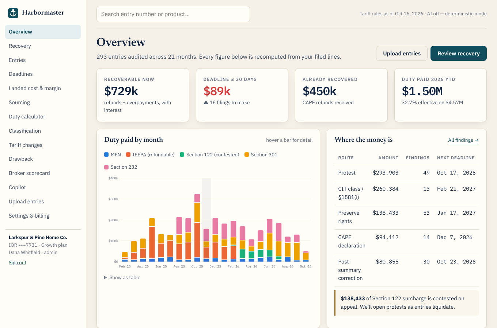

# Harbormaster

**Know what every product really costs to land. Get back what you overpaid.**

Harbormaster reads an importer's customs entries, recomputes every tariff layer on the
date each entry was made — MFN, IEEPA, Section 122, Section 301 and Section 232, with
every exemption and stacking rule — and turns the differences into refunds, corrected
filings, deadlines and prices that hold margin.

Built for the 2026 moment: the Supreme Court struck down the IEEPA tariffs (Feb 20, 2026),
CBP's CAPE process is refunding ~$166B in phases with hard deadlines, and the regime that
replaced them (s122, forced-labor §301, expanding §232) keeps re-pricing every SKU.



## What's inside

| Area | Where |
|---|---|
| Tariff stacking engine (measures, dates, exemptions, non-stacking, in-transit relief, fees) | `harbormaster/tariff/engine.py`, `catalog.py`, `countries.py` |
| Refund routing & statutory deadlines (CAPE phases, PSC, protest, CIT/class, disclosure) | `harbormaster/tariff/recovery.py` |
| Drawback matcher, sourcing simulator, tariff timeline with SKU impact | `harbormaster/tariff/drawback.py`, `sourcing.py`, `timeline.py` |
| Entry audit, CSV import (ES-003 / 7501), filings & fees, read models | `harbormaster/services/` |
| Claude: HTS classification (structured outputs) and a tool-using copilot, each with a deterministic fallback | `harbormaster/ai/` |
| FastAPI + Jinja2 + htmx web app, JSON API, server-rendered SVG charts | `harbormaster/web/` |
| Customer discovery, PRD, investment thesis, revenue & ads plan | `docs/` |

### Product surface
- **Landing page** with a live tariff-stack demo, a five-question refund estimator running
  the real engine, pricing, FAQ and a deadline-prioritised waitlist with referrals.
- **Workspace:** overview, recovery pipeline → filings (CAPE CSV, printable protest/PSC
  packet, status, success-fee ledger), entries with line-by-line "why", deadline calendar
  (.ics), landed cost & margin with one-click repricing, sourcing simulator with scenarios,
  duty calculator, AI classification with duty impact, tariff-change timeline, drawback,
  broker scorecard, copilot, CSV upload, settings & API keys.
- **API:** `POST /api/v1/stack`, `POST /api/v1/estimate`, `GET /api/v1/findings`,
  `GET /api/v1/catalog` — docs at `/api/docs`.

## Run it

```bash
python3 -m venv .venv && .venv/bin/pip install -e '.[dev]'
.venv/bin/uvicorn harbormaster.main:app --reload --port 4202
# open http://localhost:4202 — "Sign in" → "Open the demo"
```

The first boot seeds **Larkspur & Pine Home Co.**, a fictional importer with 21 months of
entries from ten countries, realistic broker errors, a completed CAPE filing and exports
for drawback. Demo login: `demo@larkspur.example` / `harbor-demo`. Demo API key:
`python -c "from harbormaster.services.seed import demo_api_key; print(demo_api_key()[0])"`.

| Variable | Default | Purpose |
|---|---|---|
| `ANTHROPIC_API_KEY` | — | Enables Claude for classification and the copilot |
| `HARBORMASTER_MODEL` | `claude-opus-5-5` | Model override |
| `HARBORMASTER_AI` | on if a key is set | `off` forces deterministic mode |
| `HARBORMASTER_DB` | `sqlite:///data/harbormaster.db` | Any SQLAlchemy URL |
| `HARBORMASTER_SECRET` | generated in `data/session.key` | Session signing key |
| `HARBORMASTER_ADMIN_TOKEN` | `dev-admin` | `/admin/waitlist?token=…` |
| `HARBORMASTER_TODAY` | today | Pin the "as of" date (tests, demos) |
| `RATE_LIMIT` | `on` | `off` disables rate limits (tests) |

```bash
.venv/bin/python -m pytest -q        # engine, recovery, web, API and AI-path tests
docker build -t harbormaster . && docker run -p 8000:8000 -v hm:/data harbormaster
```

## Accuracy and responsibility
Tariff rules are Harbormaster's reference implementation of public proclamations, CBP
guidance and court rulings through October 2026, each with its authority and status.
Harbormaster drafts; a licensed customs broker or attorney files. It is not legal advice.
