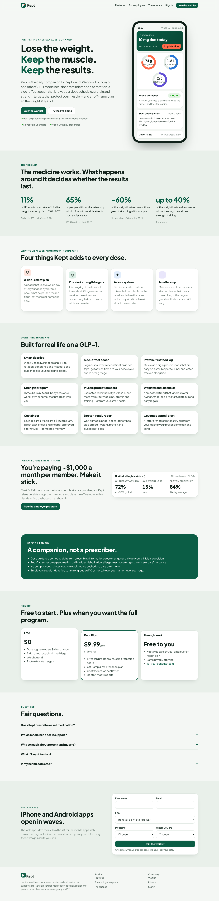
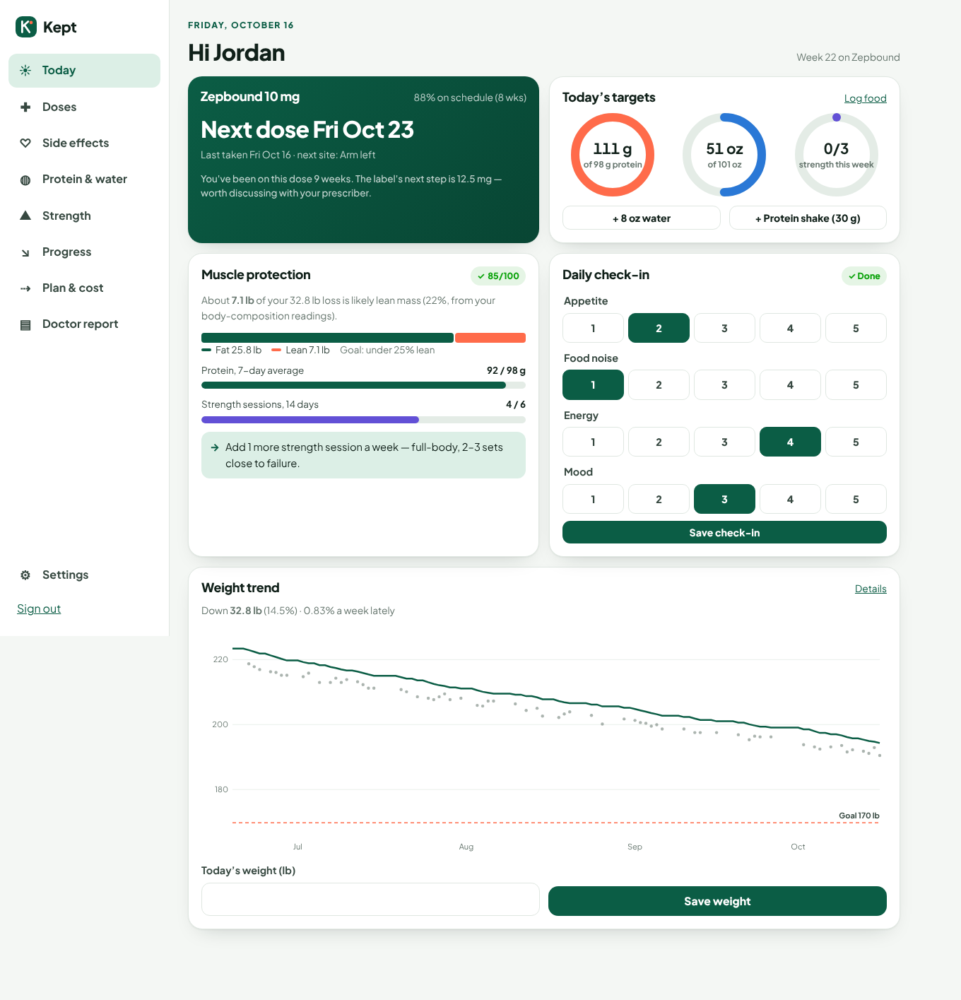
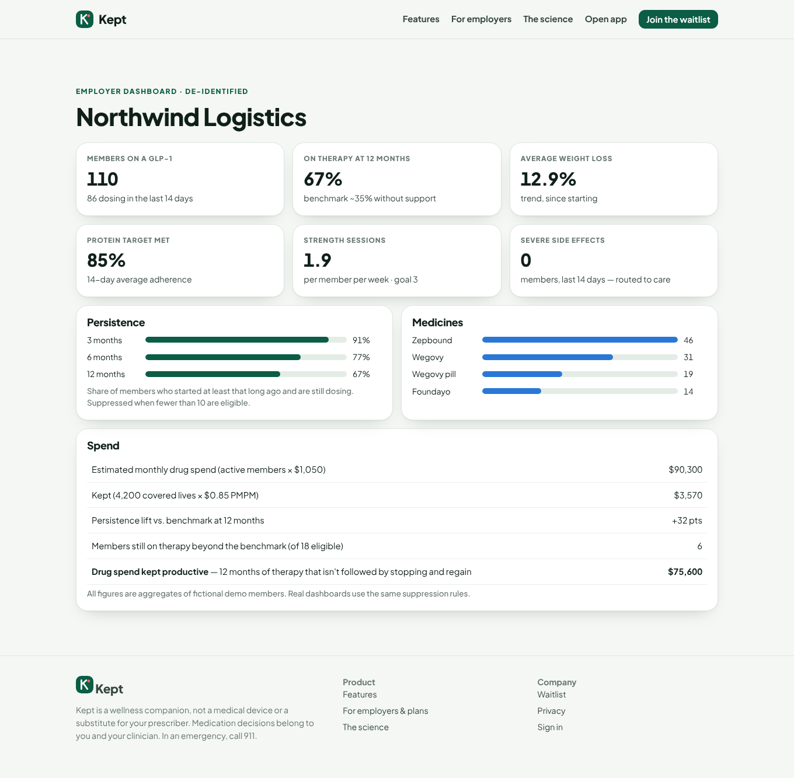
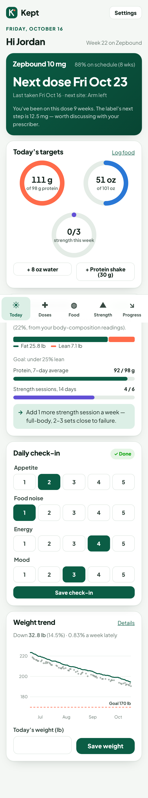
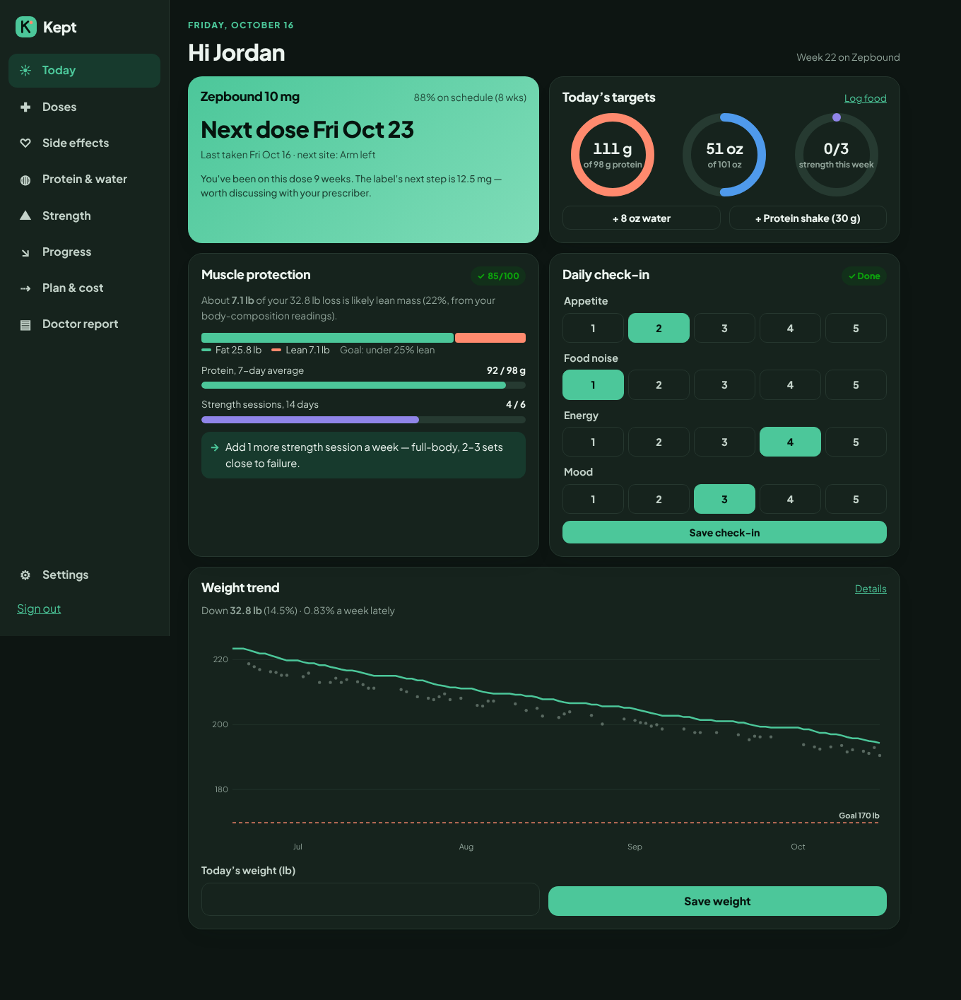

# Kept

> Lose the weight. Keep the muscle. Keep the results.

Kept is the daily companion for people on GLP-1 medicines: Zepbound, Mounjaro, Wegovy, Ozempic, the Wegovy pill, Foundayo and Saxenda.

The medicines work. What happens around them decides whether the result lasts:
- about two-thirds of people stop within a year;
- most lost weight returns within a year of stopping;
- a quarter to a third of the loss can be muscle.

Kept closes those gaps for members, and shows employers whether their GLP-1 spend is working.



## A tour

**Today** (`/app`) answers "what do I do today?" on one screen:
- the next dose with the label's missed-dose rule;
- protein, water and strength rings;
- the muscle-protection card (fat vs. lean split, protein and lifting adherence, one concrete tip);
- a two-tap check-in for appetite, food noise, energy and mood;
- the smoothed weight trend against your goal.

Safety and dose alerts sit at the top, red flags first.



**Doses** (`/app/doses`):
- the dose log with injection-site rotation;
- the label's dose ladder, showing where you are and how long until the label's next step;
- adherence over 8 weeks.

**Side effects** (`/app/symptoms`):
- log a symptom in two taps and get advice;
- label red flags (pancreatitis, gallbladder, dehydration, hypoglycaemia, allergic reaction) escalate to "seek care";
- a per-member pattern shows which day after the dose symptoms peak.

**Protein & water** (`/app/nutrition`):
- targets from adjusted body weight (2025 joint advisory, 1.2–1.6 g/kg);
- a searchable catalog of 104 appetite-friendly foods with protein, fiber and calories;
- one-tap "Again?" re-logging of your own recent foods;
- quick-add via Turbo Streams;
- a 14-day chart against target.

**Strength** (`/app/strength`): a three-day full-body program (gym or home) that rotates A/B/C, plus walks and cardio.

**Progress** (`/app/progress`):
- weight and body-composition readings;
- a trend chart that doesn't panic over water swings;
- lean-mass share, measured from your readings when available and estimated otherwise.

**Plan & cost** (`/app/plan`):
- the cost finder for your coverage: savings card, the $50 Medicare program, manufacturer and TrumpRx cash prices, cheaper FDA-approved alternatives, or an appeal, with the annual saving;
- the **off-ramp**: maintain, taper (stepping down the label ladder) or stop. Start a plan and Kept tracks the week, records each step down and your last dose, then runs **maintenance mode** off medication. A regain guardrail raises a critical alert if your trend rises 2% above where the plan started.

**Doctor report** (`/app/report`) and **coverage appeal letter** (`/app/appeal`): print-ready pages built from your logs.

**Settings**:
- an employer enrollment code that unlocks Plus;
- **calendar dose reminders**: a private iCalendar feed with a recurring dose event, an alarm, and a "talk to your prescriber" event at the label's step-up window;
- full data export (JSON and CSV);
- account deletion.

**Admin** (`/admin`, admin accounts only):
- waitlist segments by role, medicine and stage;
- CSV export with referral counts;
- product health: members, Plus, active in the last 7 days, members on an off-ramp;
- employer accounts with ARR, and creating new employers with generated dashboard and enrollment codes.

**Employer dashboard** (`/employer/northwind`, access code `northwind-demo`). Everything is aggregate and suppressed below 10 members:
- persistence at 3/6/12 months against the ~35% benchmark;
- average loss;
- protein and strength adherence;
- severe side effects;
- medicine mix;
- spend, and "drug spend kept productive".



It works on phones too: installable PWA, offline page, bottom navigation, and dark mode.

<p>
  
  
</p>

## Run it

Requirements: Ruby 3.3 and SQLite.

```bash
bundle install
bin/rails db:prepare db:seed     # ~40 s: demo member + a fictional 110-member employer
bin/rails server -p 4204
```

Open http://localhost:4204 and choose **Try the live demo**:
- **Demo member:** `demo@kept.example` / `kept-demo-2026`, "Jordan", 22 weeks on Zepbound.
- **Employer dashboard:** http://localhost:4204/employer/northwind with code `northwind-demo`. Members join with enrollment code `NORTHWIND`.
- **Admin:** `admin@kept.example` / `KEPT_ADMIN_PASSWORD` (default `kept-admin-2026`). Admins can open any employer dashboard.

Run the tests:

```bash
bin/rails test
```

There are 66 tests: domain math, models, every screen, the logging flows, the off-ramp through maintenance and restart, export and deletion, employer suppression, admin, calendar feed and auth.

### Production

```bash
docker build -t kept .
docker run -p 80:3000 -v kept-storage:/rails/storage \
  -e SECRET_KEY_BASE=$(openssl rand -hex 64) -e SOLID_QUEUE_IN_PUMA=1 \
  -e APP_HOST=kept.example -e SMTP_ADDRESS=... -e SMTP_USERNAME=... -e SMTP_PASSWORD=... kept
```

| Variable | Purpose |
|---|---|
| `SECRET_KEY_BASE` | Required; signs sessions and reset tokens |
| `APP_HOST` | Host used in password-reset links and calendar feeds |
| `SMTP_*`, `MAIL_FROM` | Outgoing mail (password resets) |
| `SOLID_QUEUE_IN_PUMA` | Run background jobs inside the web process |
| `KEPT_ADMIN_PASSWORD` | Creates `admin@kept.example` at seed time (no admin in production without it) |
| `KEPT_SEED_DEMO` | First boot seeds the demo member and fictional employer; `0` starts empty |

## How it's built

**Stack:** Rails 8.1, SQLite (Solid Cache, Queue and Cable in production), Propshaft and importmap, Turbo + Stimulus. No Node build step and no CSS framework.

**Domain logic** lives in plain Ruby objects under `app/domain/`, independent of controllers:

| Object | Responsibility |
|---|---|
| `DrugCatalog` | Label facts per medicine: ladder, step weeks, missed-dose window, form, frequency, cash prices, lean-share baseline |
| `DoseSchedule` | Next due time, missed-dose guidance, site rotation, escalation notes, adherence |
| `Targets` | Protein from adjusted body weight above BMI 30; fiber; water |
| `WeightTrend` | EMA trend, pace in %/week, too-fast / plateau / regain signals |
| `MuscleGuard` | Lean-share estimate from drug baseline × protein and strength adherence, overridden by body-composition readings |
| `SideEffectCoach` | Symptom advice, red flags, peak day after dose |
| `CostOptions` | Cheapest legitimate route by coverage, annual saving |
| `MaintenancePlan` | Maintain / taper / stop paths and guardrails |
| `DoseCalendar` | RFC 5545 feed with folding, escaping, TZID and alarms |
| `CohortReport` | Employer metrics with small-cell suppression |
| `Overview` | Assembles all of it for one member, once per request |

**Security and privacy:**
- Rails 8 authentication with bcrypt and signed, httponly session cookies.
- Built-in `rate_limit` on sign-in, sign-up, password reset, demo, waitlist and employer access.
- A strict CSP with nonces and no third-party scripts.
- A honeypot on the waitlist.
- Per-user scoping on every query.
- Constant-time comparison for employer access codes.
- Calendar tokens that members can rotate.
- The service worker never caches pages, so health data stays off a shared phone.

**Charts** are drawn by small Stimulus controllers into SVG at the container's real width. They have a crosshair tooltip, a labelled goal line, and a legend whenever there's more than one series.

## Docs

- [Press release & FAQ](docs/01-press-release-faq.md): the product, written backwards from launch, with customer, employer and internal FAQs.
- [Evidence & consumer research](docs/02-evidence-and-consumer-research.md): clinical sources behind each feature, the models, and the validation plan.
- [Revenue model & ads plan](docs/03-revenue-and-ads-plan.md): pricing, unit economics, employer go-to-market, acquisition channels and budget, and what we'll never sell.

*Kept is a wellness companion, not a medical device or a substitute for a prescriber. Medication decisions belong to members and their clinicians.*
