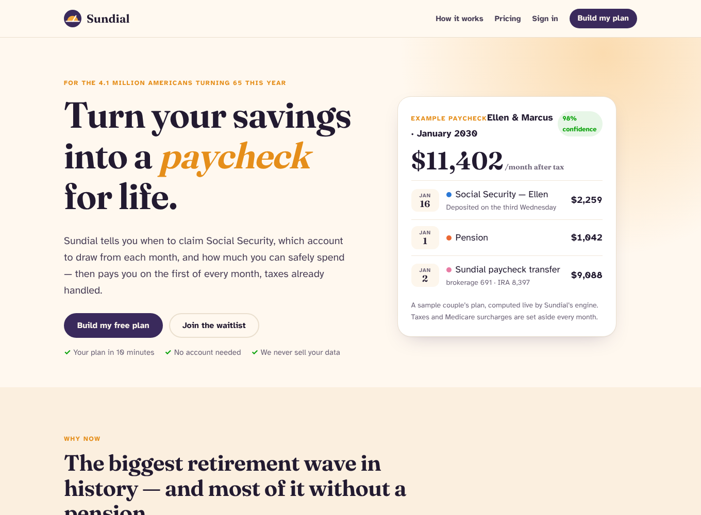
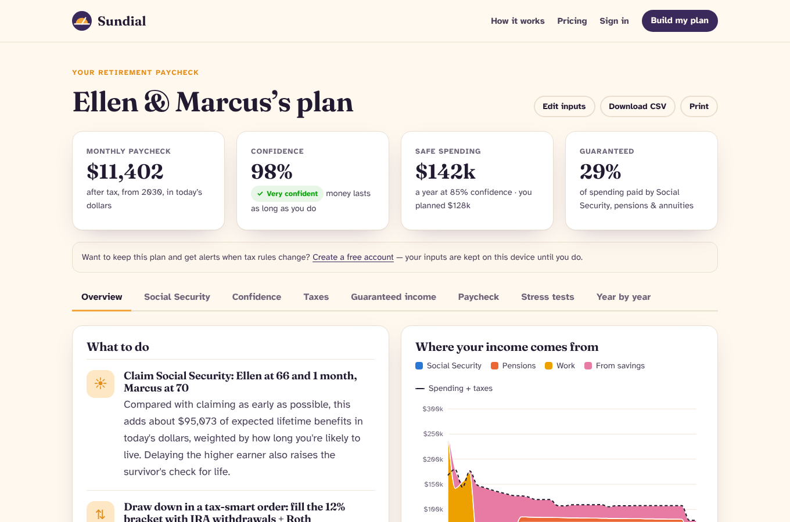
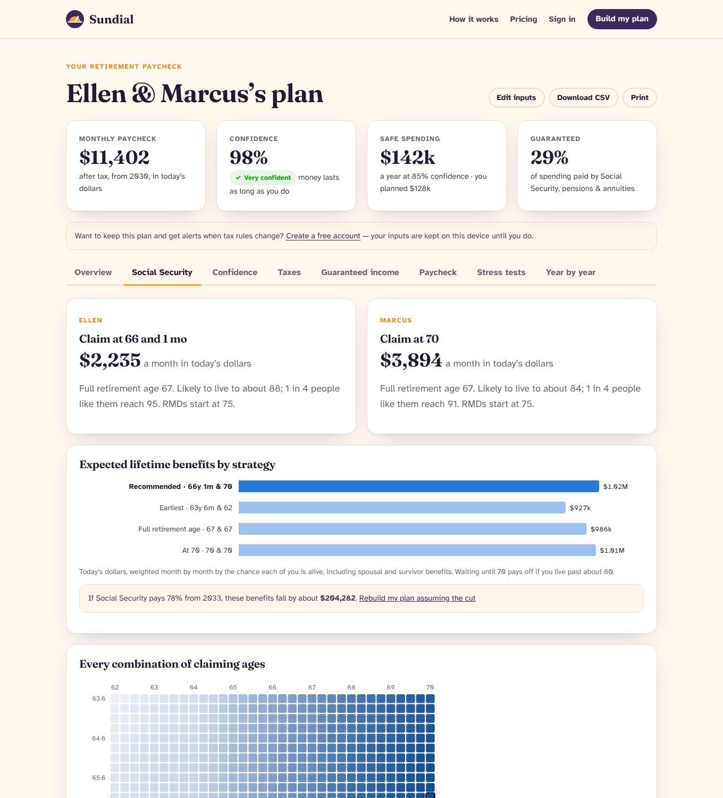
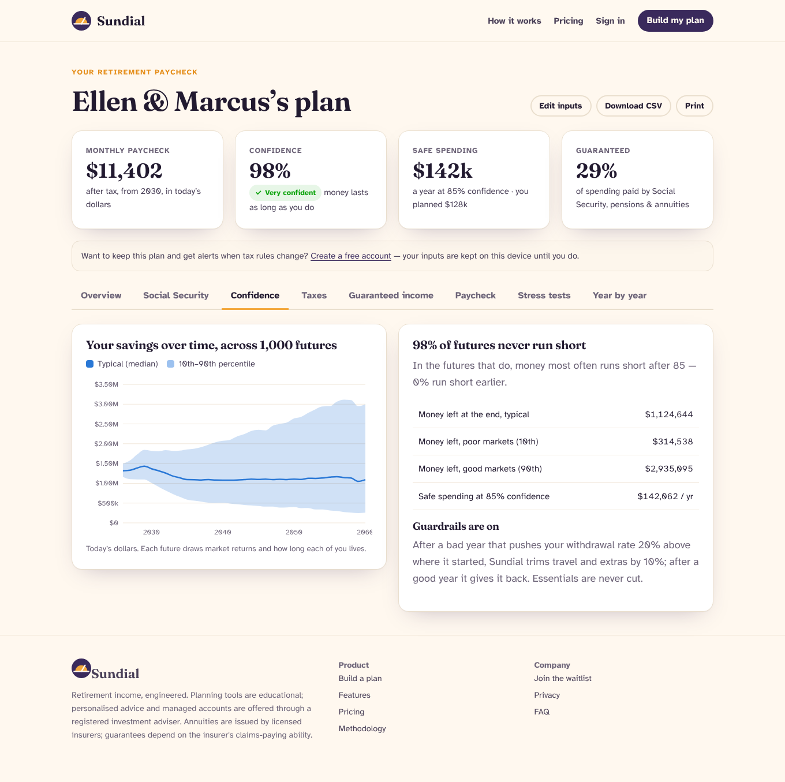
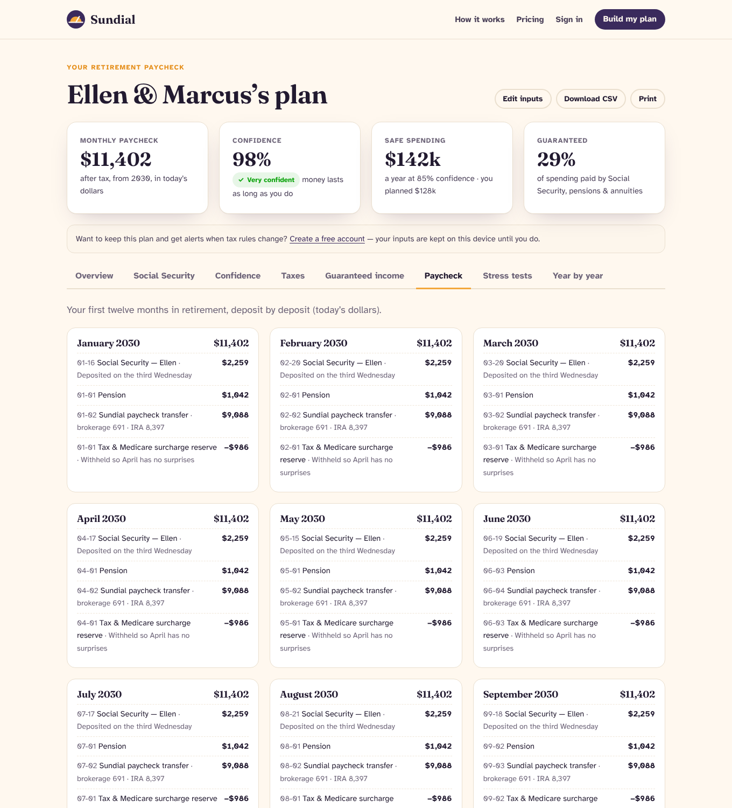

# Sundial

**Turn your savings into a paycheck for life.** Sundial tells a household when to claim
Social Security, which account to draw from each year, how much to convert to Roth, how
much income to guarantee — and turns it into a monthly paycheck with taxes set aside.





| Social Security timing | Confidence over markets and lifespans | The monthly paycheck |
|---|---|---|
|  |  |  |

## What's inside
| Area | Where |
|---|---|
| Actuarial engine: Social Security (own, spousal, survivor), mortality, 2026 federal tax incl. senior deduction, IRMAA, RMDs, annuity pricing | `src/main/java/com/sundial/engine` |
| Household simulator, Monte Carlo over markets **and lifespans**, claiming optimizer, strategy comparison, safe-spending search, stress tests, paycheck calendar | `Simulator`, `MonteCarlo`, `ClaimingOptimizer`, `Planner` |
| Spring Boot API: plans, quick claiming, annuity quotes, auth (BCrypt + session + SPA CSRF), saved plans, waitlist with referrals, planner & quote requests, admin export, rate limits, CSP | `src/main/java/com/sundial/{api,security,store,config}` |
| Flyway schema (H2 by default, PostgreSQL in production) | `src/main/resources/db/migration` |
| React + TypeScript client: landing page with live calculator and paycheck preview, 5-step planner, results with 8 tabs and charts, accounts, waitlist | `web/` |
| Research, investment memo, revenue & ads plan | `docs/` |

## Run
```bash
gradle bootRun                    # builds the React client (needs Node 20+) and starts on :4203
# or, backend only:
SKIP_WEB=1 gradle bootRun
cd web && npm install && npm run dev   # client on :5173, proxies /api to :4203
gradle test                       # engine + API tests
docker build -t sundial . && docker run -p 8080:8080 -v sundial:/data sundial
```

| Variable | Default | Purpose |
|---|---|---|
| `PORT` | 4203 | HTTP port |
| `SUNDIAL_DB_URL` / `_USER` / `_PASSWORD` | H2 file in `./data` | Any JDBC URL (PostgreSQL supported) |
| `SUNDIAL_PATHS` | 1000 | Monte Carlo scenarios per plan |
| `SUNDIAL_ADMIN_TOKEN` | dev-admin | `X-Admin-Token` for `/api/admin/*` |
| `SUNDIAL_TODAY` | today | Pin the planning date |
| `RATE_LIMIT` | on | `off` for load tests |

Try the samples: `/plan?sample=couple` or `/plan?sample=single` (fictional households).

## Assumptions
Published at `/methodology`. Plans are educational estimates; personalised advice and
managed accounts are provided through a registered investment adviser, and annuities by
licensed insurers.
